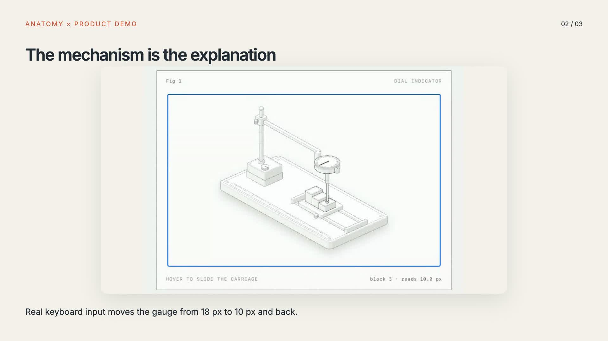
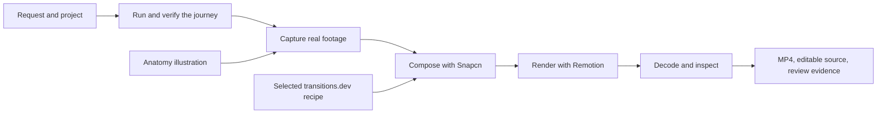

# Product demo skill

Product demo lets a coding agent such as Codex or Claude Code make a finished video of the software it is working on. It is for developers and product teams who need a demo, a feature walkthrough or a review of an issue fix, and who would rather ask for one than run the app, record the screen and edit the footage themselves. An agent can already change an interface and pass its tests without anyone having seen the result, and when asked for a video it can easily stop at a storyboard, an unrendered Remotion project or a polished mockup that proves nothing about the product.

With this skill the agent works from the running product instead. It starts the project and drives the interface with a Playwright journey that asserts each expected result, so the footage shows behavior that was checked as it was recorded. It then edits that footage in a generated [Remotion](https://www.remotion.dev/) project, using [Snapcn](https://snapcn.dev/) components and motion timing adapted from [transitions.dev](https://transitions.dev/), renders an H.264 MP4, decodes the complete file and reviews a contact sheet of sampled frames. What comes back is the video, its editable source and a statement of what was shown and tested.

[](https://github.com/chrischabot/product-demo-skill/raw/refs/heads/main/docs/assets/anatomy-demo.mp4)

[Watch the 15-second example](https://github.com/chrischabot/product-demo-skill/raw/refs/heads/main/docs/assets/anatomy-demo.mp4). The recorder pressed real keys on a working [Anatomy](https://skills.wheresryan.sh/anatomy) figure and asserted its readout at each step, and the starter composed that recording between two title scenes. [Verification](docs/verification.md) has the commands to reproduce the film and the results of its acceptance run.

The repository holds two skills. `product-demo` owns the whole video workflow, from product demos and change reviews to presentations and technical explainers. `anatomy`, an upstream skill by Ryan included under its own MIT license, builds interactive isometric figures that explain a mechanism as a physical object, for one of these videos or for a website, documentation or an article.

## Install

Install both skills globally for Codex and Claude Code with the [skills CLI](https://skills.sh/docs):

```bash
npx skills add chrischabot/product-demo-skill \
  --skill product-demo anatomy --global --agent codex claude-code
```

Leave out `anatomy` if you already have it. To install by hand, copy the complete `skills/product-demo` and `skills/anatomy` directories, not just their `SKILL.md` files, into `~/.agents/skills` for Codex or `~/.claude/skills` for Claude Code. In Fabric, open **Settings > Plugins > Install plugin or skill**, import this repository, review the two discovered skills and install them enabled.

The agent's machine needs Node.js 22 or later, npm, Chromium, FFmpeg and ffprobe, but no video-provider account for local capture and rendering. The video project installs its rendering dependencies in the agent's workspace when it needs them.

## Ask for a video

Agents can select both skills automatically from their descriptions, so an ordinary request is enough. Claude Code also exposes `/product-demo` and `/anatomy`, and Codex accepts `$product-demo` and `$anatomy`.

```text
/product-demo Show off this project's main workflow in a 30-second video.

Make these three changes, run the relevant tests, and show me a video
of what the result looks like.

Create a review video for this issue fix. Show the actual interaction
and tell me which revision and environment you tested.

Make a short presentation explaining the release, using these notes.

/anatomy Explain how a cache evicts its oldest entry, interactive,
as a React component for the documentation site.
```

The agent states its assumptions and starts rather than working through a questionnaire, so name a duration, aspect ratio, narration, audience or brand requirement only when it matters. The default is a landscape film at 1,920 × 1,080 and 30 frames per second, with readable captions and no music or narration. A vertical version needs its own reframing and visual review.

The skill handles the request in front of it. Installing it creates no issue listener or webhook, and it does not watch repositories or post GitHub comments, so automatic use on future issues needs a trigger you configure yourself. An existing, authorized issue workflow can add a video step after it has implemented and tested a fix, and attach the result to its configured review destination.

## How it works



The request decides the story. A product demo shows a useful journey and its result, a change review maps each requested change to footage and a timestamp at the resulting revision, and an explainer uses Anatomy or another clear visual built from factual source material. Beside the video source the agent writes a small `video-plan.md` with the beats, the provenance of each asset, the revision and environment, and what each beat proves. A generated mockup is never presented as proof that a feature works, a video does not replace the tests, and a local recording says nothing about what is deployed.

Motion needs particular care because browser transitions run against elapsed time, while Remotion can render frames out of order and in separate browser tabs, so a CSS transition that looks right in a browser can fail in a video. The starter therefore takes a recipe's duration, displacement, blur and easing and computes each style as a function of the current frame. A live Anatomy figure has the same problem, which is why a video either records the working figure or gives its model an explicitly seekable frame. [Motion integration](skills/product-demo/references/motion.md) and [Anatomy integration](skills/product-demo/references/anatomy-integration.md) have the details.

## Run the toolchain yourself

The agent normally drives this for you, but it also works by hand. Scaffold a video project into a new or empty directory and render its demonstration film:

```bash
git clone https://github.com/chrischabot/product-demo-skill.git
cd product-demo-skill
node skills/product-demo/scripts/scaffold.mjs /tmp/product-video
cd /tmp/product-video
npm ci
npx playwright install chromium
npm run transition
npm run typecheck
npm run render
npm run verify
```

That film exercises the renderer and shows no product. To make a real video, capture a journey into `public/` as described below and edit `src/story.ts` with the story, media paths, durations and camera positions, using `npm run studio` for an editable preview. `CHROME_PATH` can point to an existing compatible Chromium, in which case Playwright's recording also needs `npx playwright install ffmpeg`.

The render and its checks land in `out/`: `product-demo.mp4`, `poster.jpg`, a `contact-sheet.jpg` of nine sampled frames, and the `render.json` and `verification.json` records. `npm run verify` decodes the complete file and checks its codec, dimensions and duration, which catches a broken file but not a bad film, so `verification.json` marks the visual review as pending and the contact sheet and playback still have to be reviewed before delivery. [Building beyond the starter](skills/product-demo/references/composition.md) covers narration, captions, charts and other aspect ratios.

### Capture a working application

The recorder runs a JavaScript journey, whose default export receives `{page, record, hold}`, against the real interface and writes a `recording.webm`, a screenshot for each recorded step and an `evidence.json`:

```bash
npm run capture -- http://127.0.0.1:3000 journey.mjs public/feature
```

A journey that fails an assertion, records nothing, raises a browser error or runs past 120 seconds exits nonzero and leaves the failure in the evidence file. Each attempt needs a new output path, because the recorder refuses to overwrite a capture directory, and it only records pages served over HTTP or HTTPS, so footage of anything else goes into `public/` by hand. For an authenticated application, use an authorized test account and keep browser state outside the project; `CAPTURE_STORAGE_STATE` lets the recorder read it without copying it into the output. [Capture and review evidence](skills/product-demo/references/capture-and-review.md) has an example journey.

## Try Anatomy on its own

Anatomy produces framework-independent HTML and SVG or components for React and Next.js, with motion and readouts driven by the same model. From the repository root, build one of its examples as an installation check:

```bash
node skills/anatomy/examples/dial-indicator/build.mjs --light
```

Open the generated `dial-indicator-light.html` beside that script, focus the figure and press **Home** or **End** to move between gauge blocks. To reuse a figure from the existing collection in a website, the publisher offers the [`anatomy-figures`](https://skills.wheresryan.sh/anatomy/collection) npm package.

## Development

There is no root build or test command, because the toolchain lives in the scaffolded project, whose manifest and lockfile are in `skills/product-demo/assets/starter`. To check a change, follow [Verification](docs/verification.md). Its recorded run, on macOS with Node.js 26.8.2, establishes the local rendering path from a fresh scaffold to a fully decoded film, not every optional provider or every Anatomy figure. Anatomy's own checks are described in [its verification reference](skills/anatomy/references/verify.md).

## Credits and license

The original skill, scripts, frame adapter and documentation are [MIT licensed](LICENSE). Everything else keeps its own terms, and [Third-party notices](THIRD_PARTY_NOTICES.md) and [sources.json](sources.json) record the attribution, adaptations and exact revisions.

- [Snapcn](https://github.com/shadcn-labs/snapcn), by Sri Nath, is the component foundation and the basis of the workflow's product-demo guidance. Its MIT component references and the `TextReveal`, `ScreenRecording` and theme source are included with small documented adaptations.
- [Remotion](https://www.remotion.dev/docs) renders the video under [its own license](https://www.remotion.dev/docs/license), which is free for individuals, non-profits and for-profit companies of up to three employees and requires a company license from larger for-profit companies.
- [transitions.dev](https://github.com/Jakubantalik/transitions.dev), by Jakub Antalik, supplies the motion recipes. Its publisher restricts redistribution as a competing library, so the collection is not bundled or relicensed as MIT, and `npm run transition` fetches one free recipe and its license from a pinned revision into the generated project, replacing the starter's default motion values.
- [Anatomy](https://github.com/wheresryan22/anatomy), by Ryan, is included as complete MIT skill source, with its example HTML rebuilt rather than bundled.
- [HyperFrames general-video](https://www.skills.sh/heygen-com/hyperframes/general-video) and [AI video generation](https://www.skills.sh/101-skills/superpowers/ai-video-generation) were evaluated and are not bundled. [Optional video capabilities](skills/product-demo/references/optional-providers.md) explains when they might be worth their runtime or provider account.
