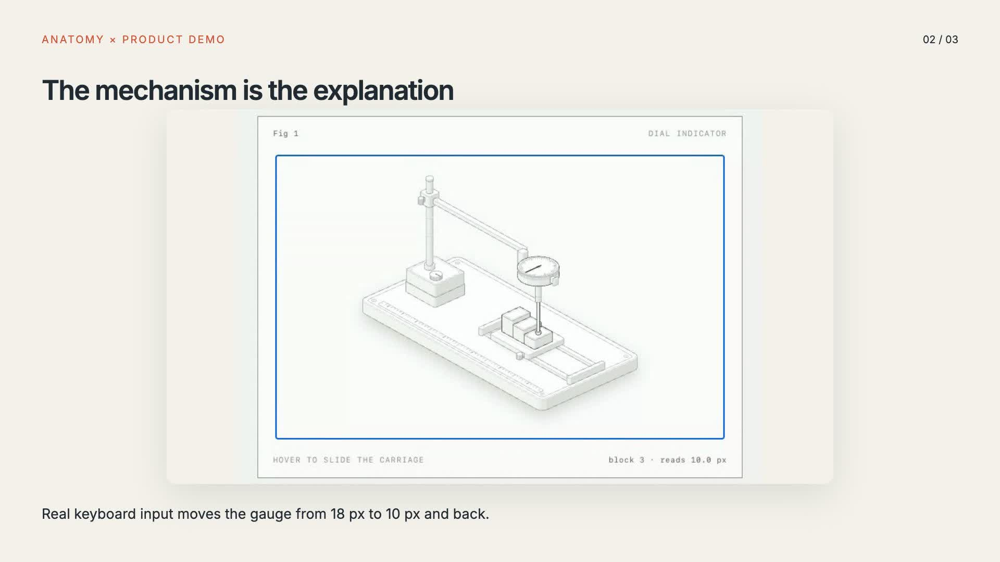
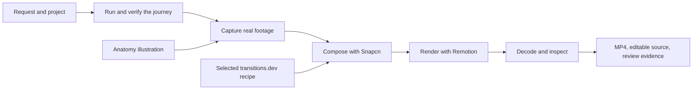

# Product demo skill

Ask your coding agent for a video of the product it is working on. This skill takes it from the running interface to a captured journey, an edited composition, and a playable MP4 with source you can change.

It also handles feature walkthroughs, issue-fix reviews, presentations, and technical explainers. [Snapcn](https://snapcn.dev/) provides the video components, [Remotion](https://www.remotion.dev/) renders them, [transitions.dev](https://transitions.dev/) supplies selected motion recipes, and [Anatomy](https://skills.wheresryan.sh/anatomy) explains mechanisms through interactive illustrations.

There are two skills to invoke. `product-demo` owns the complete video workflow. `anatomy` builds explanatory figures for videos, websites, documentation, and articles. Supporting references stay behind those entry points instead of becoming a collection of overlapping commands.

[](https://github.com/chrischabot/product-demo-skill/raw/refs/heads/main/docs/assets/anatomy-demo.mp4)

[Watch the 15.2-second example](https://github.com/chrischabot/product-demo-skill/raw/refs/heads/main/docs/assets/anatomy-demo.mp4). It records a working Anatomy figure, verifies its readouts, and composes that footage with Snapcn and motion parameters fetched from transitions.dev. For the commands and observed results, see [Verification](docs/verification.md).

## Install

Install both skills globally for Codex and Claude Code with the [skills CLI](https://skills.sh/docs):

```bash
npx skills add chrischabot/product-demo-skill \
  --skill product-demo anatomy --global --agent codex claude-code
```

You can select only `product-demo` if Anatomy is already installed. Both skills support automatic selection from their descriptions. Claude Code exposes `/product-demo` and `/anatomy`; in Codex you can explicitly use `$product-demo` and `$anatomy`, or select them through the skills interface.

For a manual installation, copy `skills/product-demo` and `skills/anatomy` into your agent's skill directory. Codex uses `~/.agents/skills`; Claude Code uses `~/.claude/skills`. Keep each complete directory, including its scripts, examples, and references. Do not copy only `SKILL.md`.

In Fabric, open **Settings > Plugins > Install plugin or skill**, import this GitHub repository, review the two discovered skills, and install it enabled. The package contains source files only; the video project installs its rendering dependencies in the agent's workspace when needed. Installation does not restart or resume existing projects.

## Ask for the result

These requests all use the same workflow:

```text
/product-demo Show off this project's main workflow in a 30-second video.

Create a product video showing the new message stream.

Make these three changes, run the relevant tests, and show me a video
of what the result looks like.

Create a review video for this issue fix. Show the actual interaction
and tell me which revision and environment you tested.

Make a short presentation explaining the release, using these notes.

Explain how our queue works with an Anatomy figure, then include it
in the product demo.

/anatomy Explain how a cache evicts its oldest entry, interactive,
as a React component for the documentation site.
```

The skill infers a reasonable format and starts from the available project. You can specify duration, aspect ratio, narration, audience, or brand requirements when they matter. Asking for a video authorizes making the video; the skill does not insert an additional routine approval before rendering.

## How the workflow works

The video follows the evidence gathered from the project:



For a product demo, the agent shows a useful journey and its result. For a change review, it maps each requested change to footage and a timestamp. For an explainer, it uses an appropriate visual mechanism and factual source material. Screenshots and recordings retain the real interface; a generated mockup is never presented as proof that a feature works.

The default is a landscape video at 1,920 × 1,080 pixels and 30 frames per second, with readable captions and no incidental music or narration. The agent can change the format to fit the request. A vertical version requires reframing and its own visual review.

## Run the rendering starter

You need Node.js 22 or later, npm, Chromium, FFmpeg, and ffprobe. No paid video-provider account is required for local capture and rendering. Remotion has its own [license terms](https://www.remotion.dev/docs/license), which apply independently of this repository's MIT license.

From a checkout of this repository, create a video project in an empty destination:

```bash
node skills/product-demo/scripts/scaffold.mjs /tmp/product-video
cd /tmp/product-video
npm ci
npx playwright install chromium
npm run transition
npm run typecheck
npm run render
npm run verify
```

The initial film demonstrates the renderer. To make a product demo, place real captures in `public/` and edit `src/story.ts` with the story, media paths, durations, and camera positions. Run `npm run studio` for an editable preview. `CHROME_PATH` can point to an existing compatible Chromium executable.

The generated project produces these artifacts:

| File | Purpose |
| --- | --- |
| `out/product-demo.mp4` | H.264 video for playback and sharing. |
| `out/poster.jpg` | A still from the completed film. |
| `out/contact-sheet.jpg` | Nine sampled frames for visual review. |
| `out/render.json` | Actual composition size, frame rate, and duration. |
| `out/verification.json` | Decode and metadata checks, with visual review left explicit. |

Verification decodes the complete file and checks its dimensions and duration. It does not replace watching the result. The skill requires inspecting the contact sheet, important interactions, scene boundaries, captions, and audio before delivery.

## Capture a working application

The starter includes a browser recorder that accepts a JavaScript journey. The journey uses Playwright to operate the real UI, asserts the expected result, and records evidence at meaningful moments:

```bash
npm run capture -- http://127.0.0.1:3000 journey.mjs public/feature
```

The output includes a recording, screenshots, and an evidence file. For an authenticated application, use an authorized test account and keep browser state outside the project. The helper accepts `CAPTURE_STORAGE_STATE` without copying the authentication file into the output. For the journey contract and an example, see [Capture and review evidence](skills/product-demo/references/capture-and-review.md).

## Add transitions.dev motion

Browser CSS animations run against elapsed time. Remotion can render frames out of order, so a CSS transition that looks correct in a browser can fail in a video. This skill converts the selected recipe's timing and easing into a function of the video frame.

`npm run transition` fetches the pinned free text-state recipe directly from transitions.dev, retains its license and attribution, and writes the timing parameters consumed by the starter's original frame adapter. The starter uses its entrance phase for headings and captions. For a status swap, the agent sequences both the outgoing and incoming phases. Scene overlaps use Remotion's `TransitionSeries`.

The transitions.dev collection is **not bundled or relicensed as MIT**. Its publisher permits application use but restricts redistribution as a competing library. Fetch only the recipes needed by the generated project, and retain their terms. For the rendering details, see [Motion integration](skills/product-demo/references/motion.md).

## Use Anatomy in a website or film

Anatomy is included as a separate upstream skill with its geometry kit, reference material, verification scripts, and eight source examples. It creates detailed isometric mechanisms whose motion and readouts come from the same model. It can produce framework-independent HTML and SVG or components for React and Next.js.

For the existing collection, the publisher also offers the `anatomy-figures` npm package. That package is an optional dependency of the website using it, not a global prerequisite for this skill. See the [Anatomy collection and component examples](https://skills.wheresryan.sh/anatomy/collection).

For a video, record the working figure or make its model explicitly seekable by frame. A live animation mounted in Remotion without that adaptation is not deterministic. The included example build is a useful installation check:

```bash
node skills/anatomy/examples/dial-indicator/build.mjs --light
node skills/anatomy/examples/dial-indicator/build.mjs
```

Open the generated pages, focus the figure, and press **Home** or **End** to move between gauge blocks. For the two integration approaches, see [Anatomy integration](skills/product-demo/references/anatomy-integration.md).

## Use it after an issue fix

Add a video step to an existing, authorized issue workflow: after implementing and testing the fix, invoke `product-demo`, capture the acceptance criteria at the resulting revision, and attach the artifact to the configured review destination. Keep the revision, environment, test results, and video timestamps together.

Installing a skill does not create an issue listener or webhook. This repository does not silently watch repositories, post GitHub comments, or resume paused work. The current agent can fulfill a request such as "fix this issue and show me a video" directly. Automatic use on future issues requires a configured trigger.

## Sources and design decisions

These projects inform the workflow:

| Source | Role and decision |
| --- | --- |
| [Snapcn](https://github.com/shadcn-labs/snapcn) | The main component foundation. Includes its MIT component references, `TextReveal`, `ScreenRecording`, and theme module, with limited adaptations documented in the notices. |
| [Remotion](https://www.remotion.dev/docs) | Deterministic React composition and local rendering. The starter pins matching package versions and includes a lockfile. |
| [transitions.dev](https://github.com/Jakubantalik/transitions.dev) | Selected interaction timing and motion recipes, fetched upstream when used. Kept outside the MIT source distribution. |
| [Anatomy](https://github.com/wheresryan22/anatomy) | The complete MIT skill source for technical illustrations. Generated example HTML is rebuilt rather than bundled. |
| [HyperFrames general-video](https://www.skills.sh/heygen-com/hyperframes/general-video) | Evaluated as an HTML composition alternative. Its broader runtime and companion skills make it an optional route, not a prerequisite for the default workflow. |
| [AI video generation](https://www.skills.sh/101-skills/superpowers/ai-video-generation) | Evaluated for generated illustrative footage, avatars, and image-to-video. Provider accounts and charges remain optional; generated clips do not replace real product evidence. |

Exact reviewed revisions are recorded in [sources.json](sources.json). For attribution, adaptations, and dependency terms, see [Third-party notices](THIRD_PARTY_NOTICES.md). For optional providers, see [Optional video capabilities](skills/product-demo/references/optional-providers.md).

## License

The original skill, scripts, adapter, and documentation are [MIT licensed](LICENSE). Bundled Anatomy and Snapcn material retain their own MIT notices. Runtime dependencies, media, fonts, and externally fetched transition recipes retain their respective licenses.
